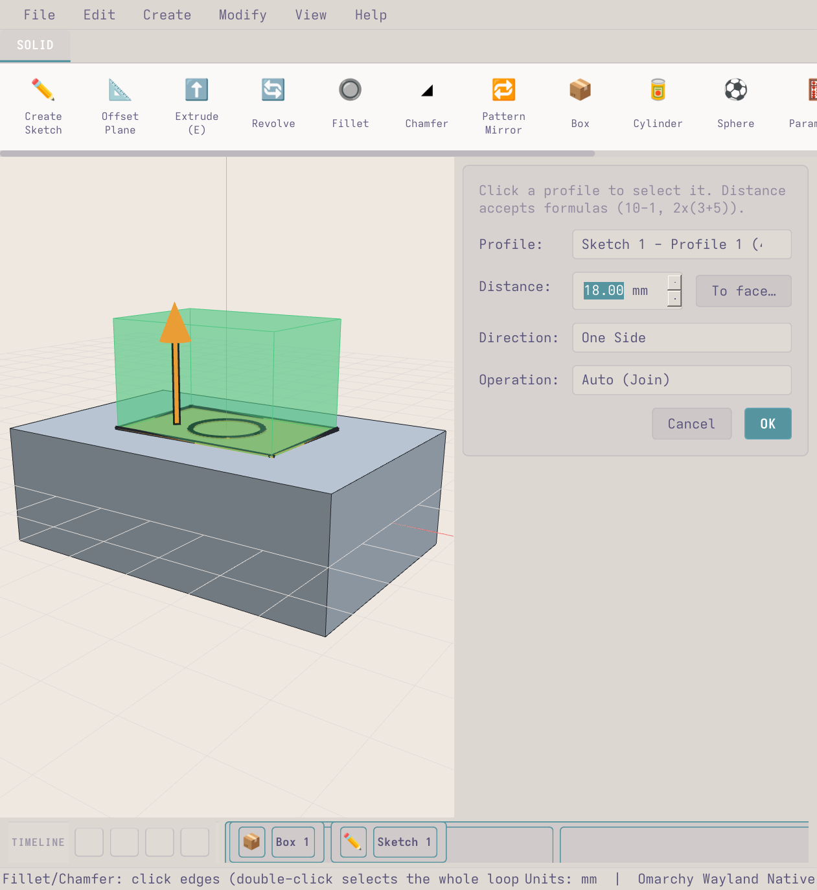
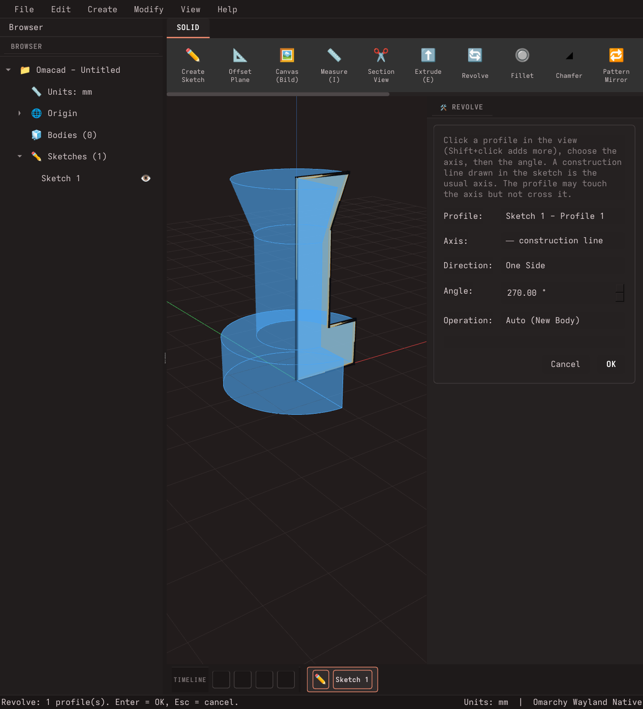
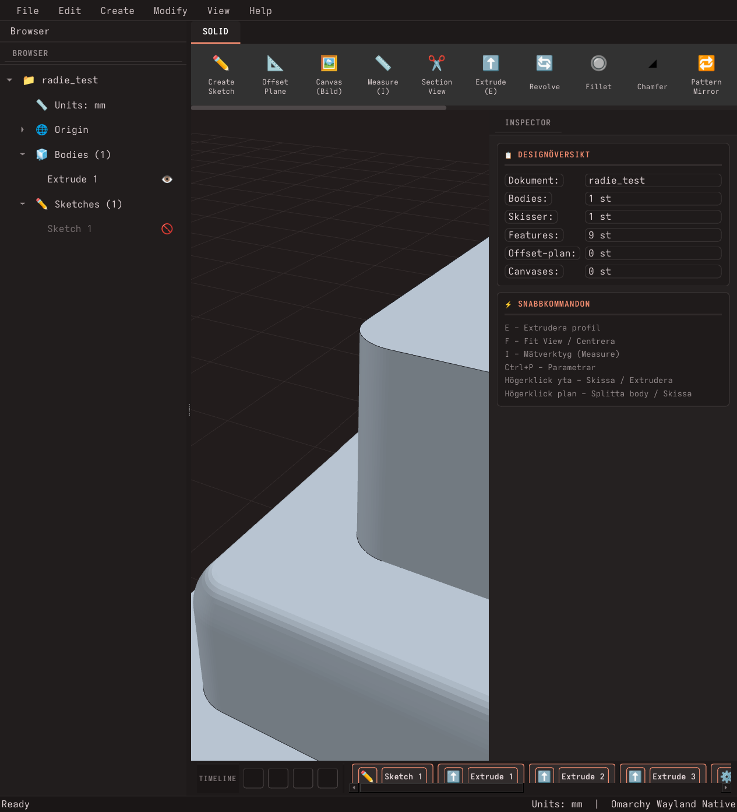

# Omacad ⚡

**Version 0.5.1** (se [CHANGELOG.md](CHANGELOG.md)). 0.x medan funktionerna växer, 1.0 när Omacad är ett komplett och pålitligt CAD.

**Omacad** är ett native parametriskt 3D CAD-program för **Omarchy Linux** (Arch + Hyprland/Wayland), inspirerat av **Autodesk Fusion 360**.
Byggt med **Python 3.14**, **PySide6 (Qt6) + OpenGL**, **manifold3d** (vattentäta booleans), **shapely** och **SolveSpace** (skiss-villkor).
Fönstret följer Omarchys aktiva tema och typsnitt.


## Funktioner

**Skissa**
- Skissa på origin-plan, på valfri plan yta (högerklick → *Create Sketch on this Face*) och på egna plan (Offset Plane).
- Linje, rektangel, centrumrektangel, cirkel, 3-punktsbåge, slot och **regelbunden polygon** (`P`: trianglar, hexagoner ... klicka mitten, Tab ger sidlängd och antal sidor). Snäpper mot hörn, kanter, mittpunkter, rutnät och kroppens kanter.
- **Tab-inmatning** medan du ritar (längd, vinkel, bredd/höjd, diameter) – Enter går vidare, Esc ångrar.
- **Mått och villkor** (SolveSpace): horisontell, vertikal, parallell, vinkelrät, lika, tangent, koncentrisk, fixerad, avstånd, längd, vinkel, diameter, punkt–linje. Guidad högerklicksmeny på varje element.
- Markera (klick, **Shift/Ctrl+klick** lägger till och tar bort), flytta (dra eller `M` med dx/dy), ta bort, ångra/gör om.
- **Offset (`O`)** som i Fusion: klicka en kurva så följer hela den sammanhängande kedjan med, klicka fler för att lägga till (Alt+klick = ett element), Enter anger avstånd med förhandsvisning (negativt = inåt).
- **Trim (`T`)**: ta bort biten av en linje, cirkel eller båge fram till närmaste korsning eller fria ände (tar bort lösa stumpar).
- **Mirror (`Shift+M`)** i skissen: välj former, sedan en linje eller origoaxel att spegla över.
- **Ytans kanter som skisslinjer**: skissar du på en yta följer dess yttre linjer, hål och bågar med som riktiga (lila) skisselement. De går att offsetta, trimma, snappa mot och rita vidare från. *Include Face Edges* i skisspaletten stänger av det, och **Project (edges)** tar in kanterna i vilken skiss som helst.
- **Skiss-Fillet (`F`)**: klicka ett hörn, eller **Shift+klicka** flera hörn, eller **dra en ruta** runt alla hörn du vill ha, och tryck Enter för en radie till alla (förhandsvisning, ett ångra-steg).
- **Rutmarkering** i skissen: dra en ruta på tom yta (vänster→höger = bara det som ligger helt innanför, höger→vänster = allt rutan rör vid). Ctrl+dra lägger till. **Alt+dra** roterar vyn i skissläget.
- **Canvas / Referensbild**: Infoga ritningar och referensbilder på valfritt plan. Bildredigering (ljusstyrka, kontrast, invertering, gråskala, rotation, beskärning) och **kalibrering med virtuellt måttband** (klicka två punkter och ange mm) för att rita av i skala 1:1.

**Solider**
- **Extrude** med dragbar pil i vyn *och* inskrivet värde, riktning (en sida, symmetriskt, två sidor), *To face…*, Auto / New Body / Join / Cut / Intersect. Förhandsvisning och profilval i vyn: inget väljs åt dig, klicka på en profil och **Shift+klick** lägger till eller tar bort fler (t.ex. ringen och cirkeln i den). Extrudera också en hel yta.
- **Revolve**: profil, axel (en konstruktionslinje eller någon linje i skissen, eller skissens X/Y-axel), vinkel (360 = helt varv, negativt vänder), One Side / Symmetric / Two Sides, Auto / New / Join / Cut / Intersect, med förhandsvisning.
- Box, Cylinder, Sphere, Combine (Join/Cut/Intersect).
- **Split Body**: Dela en solid kropp i två separata kroppar med ett offset-plan eller origin-plan.
- **Move / Rotate Body (`M`)**: Flytta ($dx, dy, dz$ mm) och rotera ($rx, ry, rz$ grader) solida kroppar parametriskt med realtidsförhandsvisning och formelstöd.
- **Shell (Urholka)**: Skapa ihåliga solider. Riktning: Inside, Outside eller Both (separat tjocklek inåt och utåt), som i Fusion. Klicka på ytor i 3D för att lämna dem öppna (t.ex. toppen på en låda); utsidan kapas jämnt med den öppna ytan.
- **Fillet och Chamfer** på raka kanter, cirklar (skruvhål, försänkningar) och hela konturer med rundade hörn. Inre och yttre kanter, dubbelklick väljer hela loopen, samt **interaktiv 3D-pil** direkt på kanten för att justera storleken. Kantval: `X`/Alt ser genom modellen (dolda kanter, trappor), Shift+dubbelklick väljer loopen på kantens andra sida, Ctrl+klick tar bort en kant, Backspace ångrar senaste, Ctrl+Backspace rensar. Fasen följer ändrade tidigare steg (flyttade kanter hittas igen) och inre hörn får en ren gering.
- **Pattern / Mirror**: jämnt fördelade kopior, speglade hörn eller **över ett valfritt plan** (origo- eller offset-plan), eller runt en axel, med förhandsvisning.
- **Fill the face** (Pattern/Mirror → *Fill the face*): fyller en yta med kopior med exakt fast mellanrum (kant till kant, så hexagoner, cirklar och trianglar packas rätt), valfri ramkant (offset) mot kanten, rutnät eller förskjutet (bikake). Undviker automatiskt utskjutande detaljer på ytan.
- **Offset Plane**: Välj valfritt plan (XY/XZ/YZ, konstruktionsplan eller plan yta på kropp). Ange avstånd exakt i mm, dra i den lila 3D-pilen, använd formler/parametrar, eller klicka *To surface…* för att tangera en yta.

**Import & Export**
- **Import 3MF**: Läs in 3D Manufacturing Format (`.3mf`) direkt som parametriska kroppar med bibehållen skalning och positionsmatris.
- **Export STEP**: Exportera solider till industristandarden ISO 10303-21 AP214 (`.step` / `.stp`) för direkt användning i Fusion 360, SolidWorks, FreeCAD, Bambu Studio eller PrusaSlicer.
- **Export STL / OBJ**: Direkt export för 3D-utskrift och rendering.
- Spara/öppna `.omacad` (JSON) med fullständig parametrisk historik.

**Se in i modellen**
- **Measure** (`I`, knappen i både SOLID och SKETCH): klicka på en linje, cirkel eller kant för längd/diameter, klicka på en andra för avstånd (parallella) eller vinkel och kortaste avstånd. Gäller skisselement i skissläge och kroppskanter i 3D.
- **Section View** (✂️ i bandet, View-menyn): välj XY/XZ/YZ, en yta eller ett eget plan, och skjut snittet genom modellen med reglage, inskrivet värde eller genom att dra i den blå pilen. Snittytan färgas, med "se från andra sidan". Sparas som en **Section View i trädet** (öga för av/på, högerklick: ändra, döp om, ta bort) och följer med i filen.

**Parametriskt**
- **Parametrar** med namn och formler (`bredd/2`, `10-1`, `2x(3+5)`) i alla fält.
- **Tidslinje**: klicka på ett steg för att ändra det, dubbelklick redigerar, rulla tillbaka/framåt, undertrycka steg.
- Sketcher döljs automatiskt när de använts; ögon i trädet.

**Gränssnitt**
- Ribbon, bläddrare (döp om med F2), tidslinje, ViewCube.
- **Högerpanel (Inspector)**: Verktygsdialoger (Extrude, Fillet, Shell, Move, Offset Plane, Split Body) dockas prydligt i högerpanelen så de aldrig skymmer 3D-modellen, och visar geometri- och mätdata i realtid.








## Köra

```bash
./run.sh
```
eller sök efter **Omacad** i Omarchys appmeny (`omacad.desktop`).

## Paketering för Windows

Omacad kan paketeras som en kompakt, fristående enskild `.exe`-fil för Windows utan att mottagaren behöver ha Python installerat.

### Bygg kompakt enskild .exe (Onefile)
Kör byggskriptet [`build_windows.bat`](build_windows.bat) eller i terminalen:
```powershell
pip install PySide6 numpy manifold3d trimesh PyOpenGL Pillow shapely pyinstaller
pyinstaller --clean omacad.spec
```
Den färdiga appen hamnar som en enda körbar fil i `dist\Omacad.exe` (optimerad med UPX och exkluderade tunga bibliotek för minsta möjliga filstorlek).

## Installation av skisslösaren

`python-solvespace` saknar wheel för Python 3.14, bygg så här:

```bash
CFLAGS="-std=gnu17" CXXFLAGS="-std=gnu++17" uv pip install --python .venv/bin/python python-solvespace
```

## Begränsningar

Fillet/chamfer gäller raka kanter mellan plana ytor, hela cirklar och konturer med raka stycken + bågar med räta väggar (inte koner eller delbågar). Mönster, ytskisser och offset-plan är inte associativa. Ändringar i tidslinjen går inte att ångra (skisser går). Bågar och slots finns inte i skisslösaren än. Kanter som inkluderats från en yta ligger kvar där de var om kroppen ändras senare.

## Färdplan

Mål: efterlikna Fusion 360 så nära det går. Närmast: Hole-dialogen (funktionen finns i modellen), Extrude med Taper/Start-offset/All, Press/Pull (`Q`), global ångra, ortografisk kamera och visningslägen, fler skissverktyg (Extend, Break, ellips, spline), Sweep/Loft, Draft. Se `ROADMAP.md` och `CHANGELOG.md`.

## English summary

Omacad is a native parametric CAD program for Omarchy Linux, modelled on Fusion 360 (version 0.5.0; 1.0 = a complete CAD). Sketch (lines, rects, circles, arcs, slots, regular polygons; offset, trim, mirror, face edges as sketch lines) with SolveSpace constraints and formula-driven dimensions; extrude with a draggable arrow, revolve, shell (inside/outside/both), fillet/chamfer (including circles and whole outlines), pattern/mirror including a *fill the face* mode with fixed gaps and a frame, offset planes, section views saved in the tree, measuring, parameters and a timeline you can edit. See **`ROADMAP.md`** for the step-by-step list of what is done and what remains.
